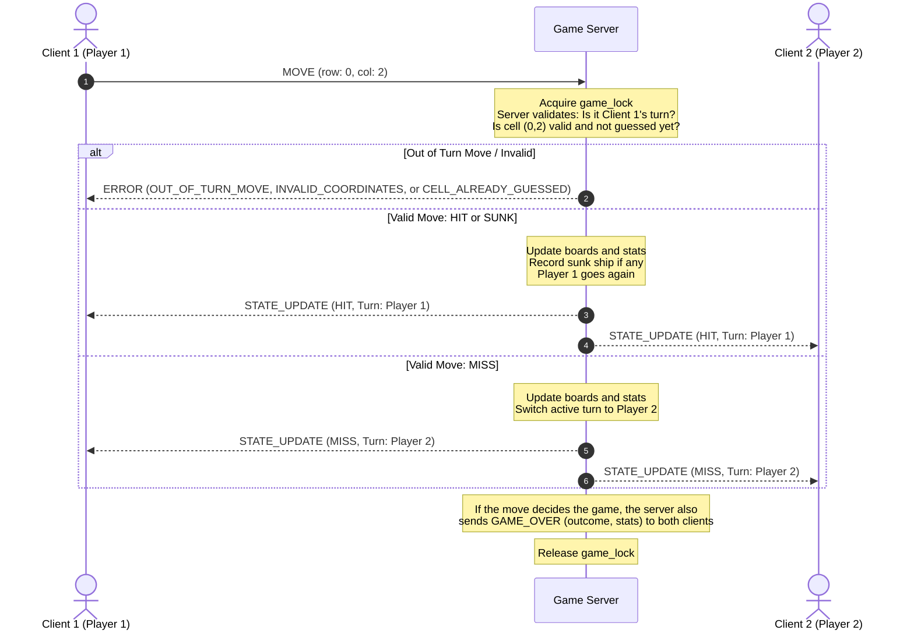

# Game Behavior & Server Concurrency Architecture Design

## 1. Server Concurrency Model: Multi-Threading
The server is multi-threaded, with one thread per connected client. This fits Battleship because each player gets their own thread. While one thread waits for Player 1's move, the other can still receive Player 2's messages (such as a `DISCONNECT` or an out-of-turn `MOVE`), so one player never blocks the other.

### Connection Lifecycle 
1. **Listen:** The main thread creates, binds, and listens on the server socket.
2. **Accept and register:** Each `accept()` returns a client socket. The first client becomes Player 1 and the second becomes Player 2. The socket is added to the shared client list (under the lock) and a dedicated worker thread (`threading.Thread`) is started for it. The game starts once both players are connected.
3. **Game loop:** Each worker thread loops on `recv_message(sock)` and passes each message to the game logic.
4. **Teardown:** When the game ends (`GAME_OVER`) or a client disconnects, the worker closes its socket, removes it from the client list and exits its loop.

## 2. Thread Safety & Lock Acquisition Strategy 
Both client threads read and change the same game state: the boards, whose turn it is, the stats, and the client sockets. A single `threading.Lock` protects all the shared state so the threads can't interfere with each other.

- Reading a message from the socket happens outside the lock, so a slow player never blocks the other thread.
- Handling a message happens inside a `with game_lock:` block from start to finish, so the lock is released automatically when the block ends. That includes the turn check, move validation, board and stats updates, win/draw check, and sending the `STATE_UPDATE` (or `ERROR`) messages. Because all of this happens in one locked block, two moves can never be processed at the same time.
- Disconnect handling takes the same lock and checks a `game_over` flag, so `GAME_OVER` (FORFEIT) is only sent once even if both threads notice a disconnect at the same time.

With only one lock, deadlock between locks can't happen. If a send fails inside the locked block, the error is caught and noted, and the disconnect is handled after the lock is released. That way a thread never tries to take a lock it already holds. 

## 3. Client State & Turn Synchronization Scheme

## 4. Move Flow
When a client sends a `MOVE`, the worker thread takes `game_lock` and the server checks the turn and the cell. An invalid or out-of-turn move gets an `ERROR` only to the sender and the game state doesn't chang. A valid `MOVE` updates the game state and the server sends the same `STATE_UPDATE` to both clients before releasing the lock. A hit lets the same player go again, and a miss switches the turn.

## 5. Score & Leaderboard Synchronization
**Storage:** Stats are kept in server memory as part of the shared game state with one entry per player (shots, hits and ships sunk). They are only changed inside `game_lock`, each time a valid move is processed

**Broadcast:** The score table is sent when the game ends. Once the game is decided, the server sends the `GAME_OVER` message to both clients, still inside the same locked block. It contains the outcome (win, loss, or tie) and both players' stats, so both clients show the same final score table 