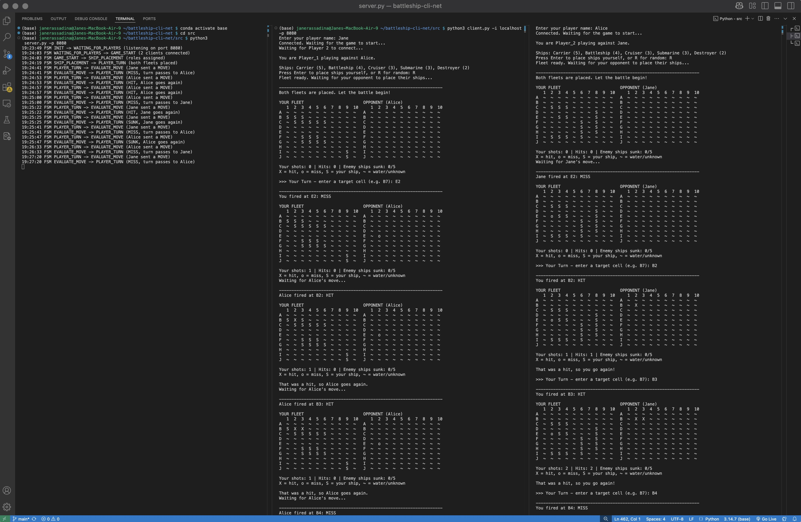
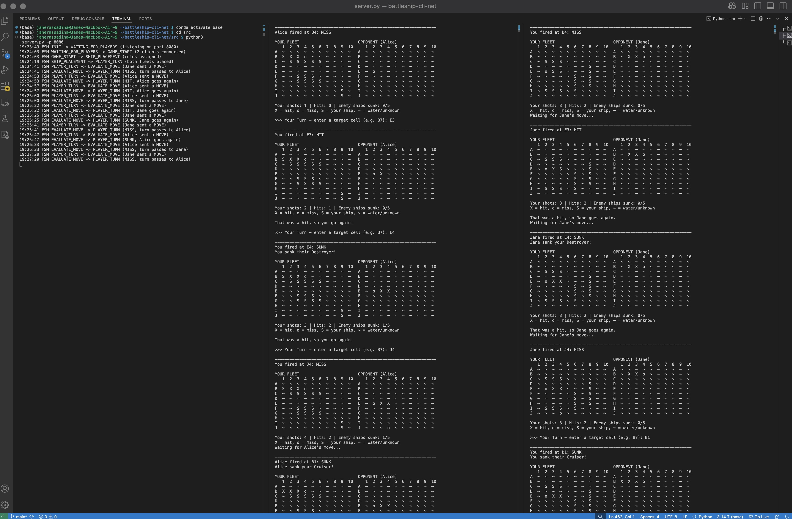

# Execution Log (localhost)

Tested on localhost with the server and two clients running at the same time.

## Start of the game

Server log and both clients: connection, role assignment, ship placement, and the first turns.

## Later turns

Both clients' boards after several turns each, with the server log showing the turn order.