# Sprint 4: Network Verification Report

## 1. Topology

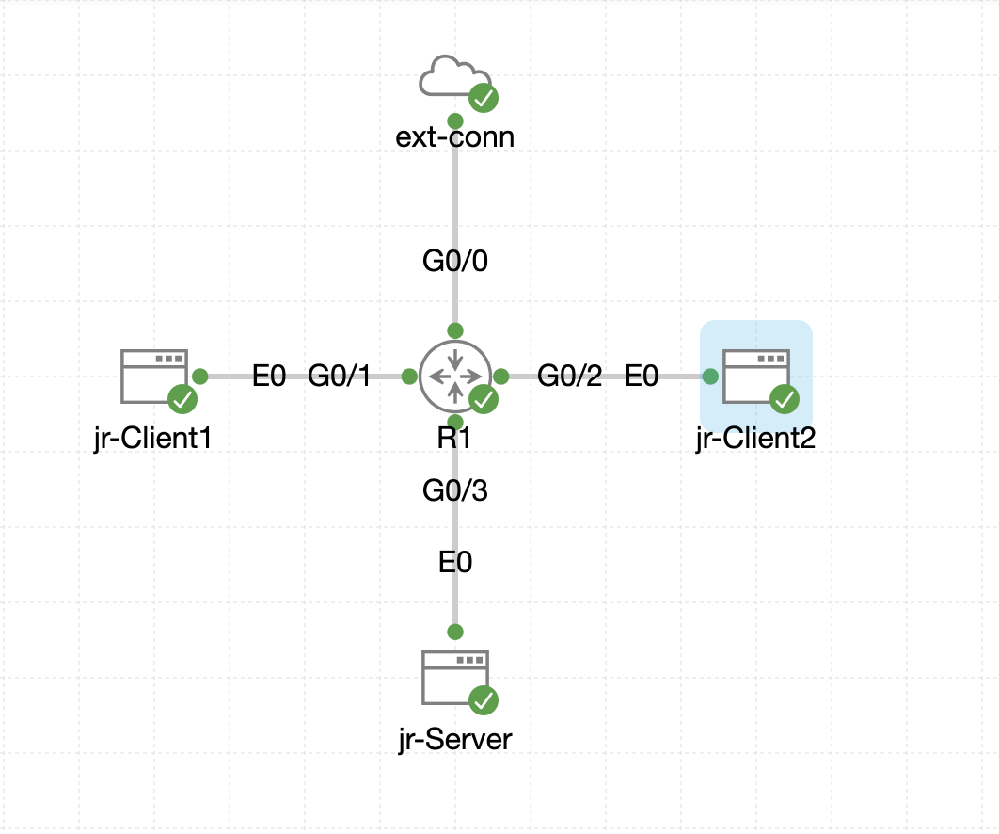

## 2. Router R1 Verification

### 2.1 Interface status (`show ip interface brief`)

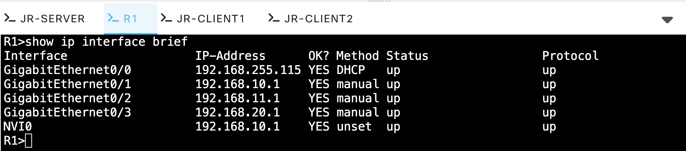

### 2.2 Routing table (`show ip route`)

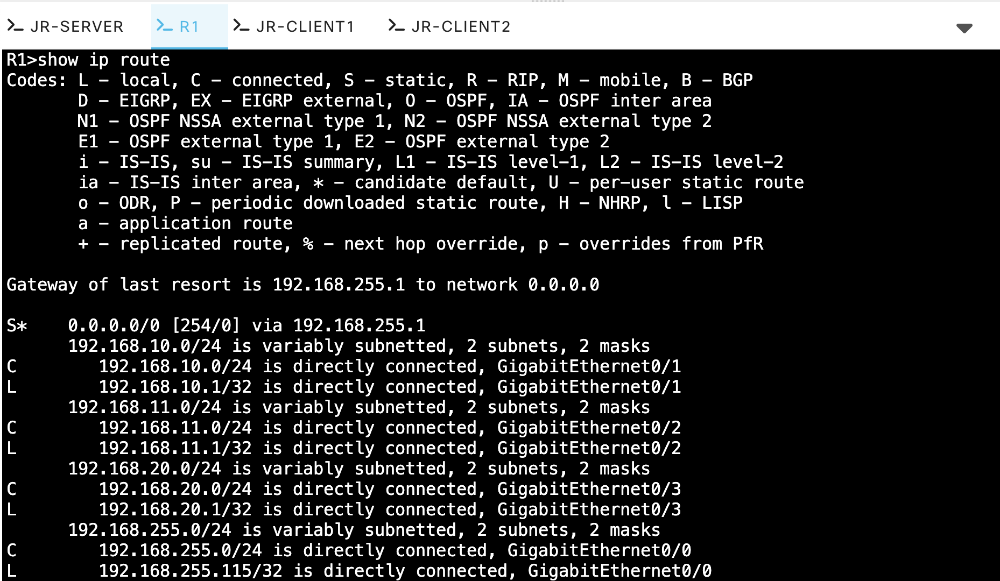

### 2.3 DHCP leases (`show ip dhcp binding`)

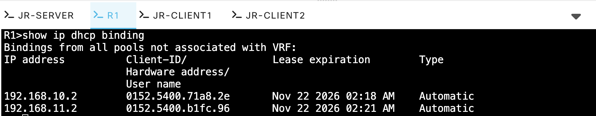

## 3. Game Server Configuration

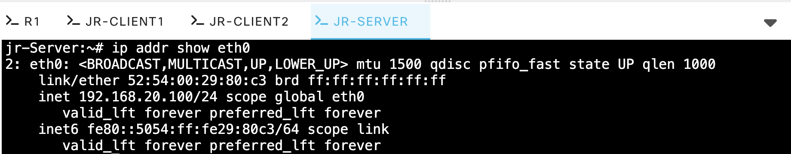
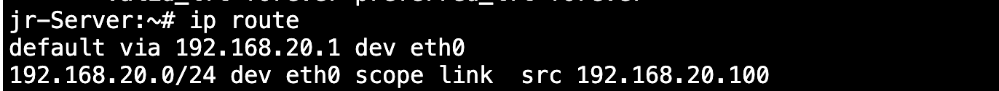

## 4. Cross-Subnet Connectivity

### Client 1 to the game server

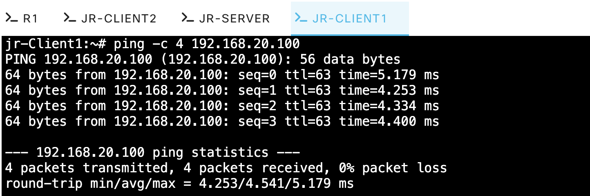

### Client 2 to the game server

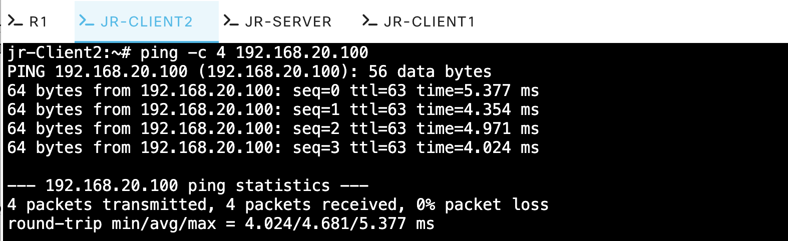

## 5. DNS Resolution

### Client 1 nslookup server.rassadina.edu

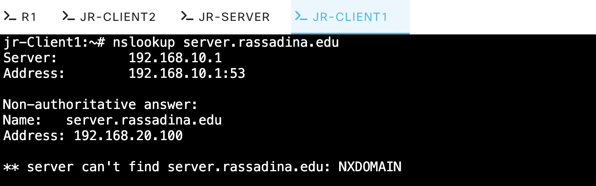

### Client 2 nslookup server.rassadina.edu

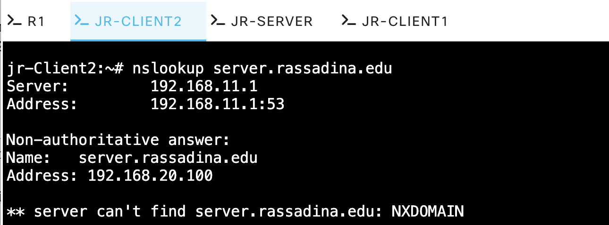

## 6. Wireshark DNS Capture

Capture file: [`sprint_4_dns_lookup.pcap`](sprint_4_dns_lookup.pcap), taken on the link between R1 and Client 1 while running `nslookup server.rassadina.edu`.

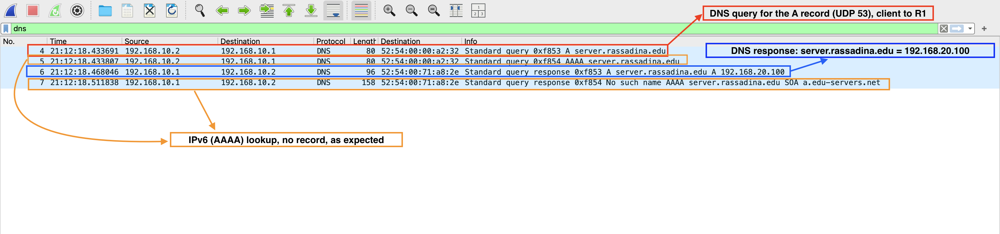

- **Query:** Client 1 (192.168.10.2) sends a standard DNS query for the A record to R1 (192.168.10.1) on UDP port 53.
- **Response:** R1 answers with `server.rassadina.edu` = `192.168.20.100`.
- The second query/response pair is the IPv6 (AAAA) lookup that `nslookup` sends along with the IPv4 one. R1 only has an IPv4 host record, so that lookup returns "No such name", which is expected.
